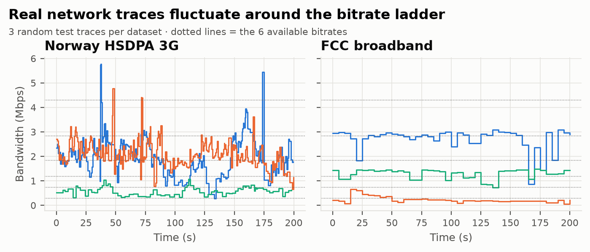
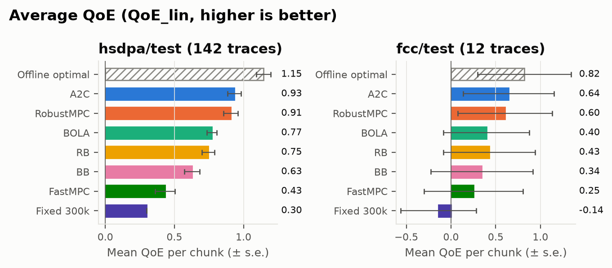
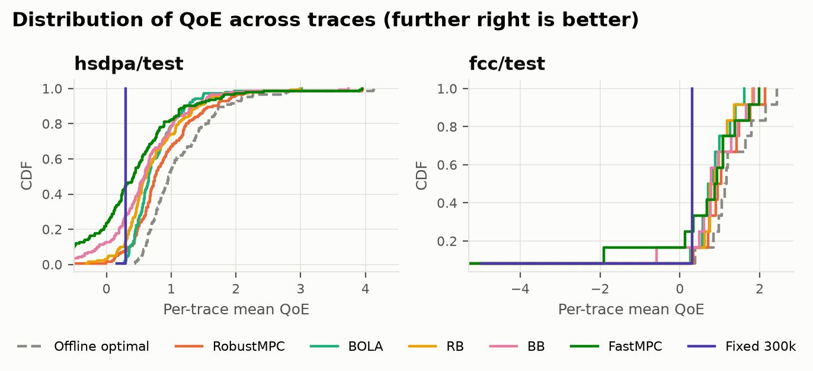
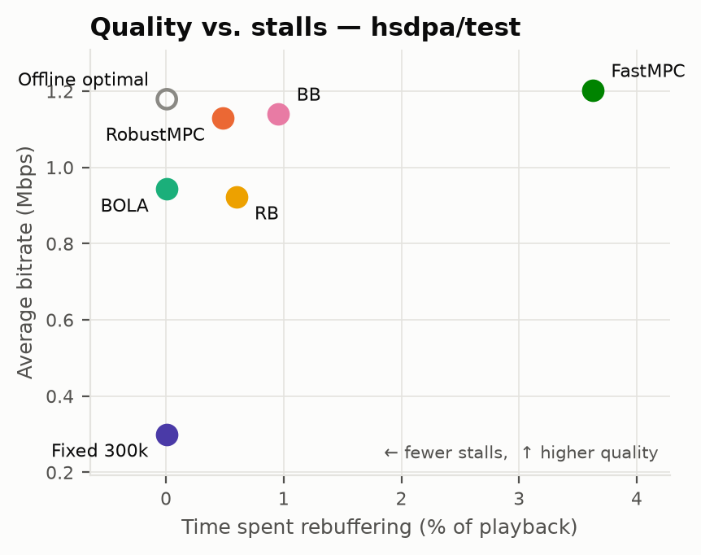

# Adaptive Bitrate (ABR) Streaming with Deep Reinforcement Learning

## Quick Start

```bash
python3.12 -m venv .venv && source .venv/bin/activate
pip install -r requirements.txt
python tools/prepare_traces.py   # (only if data/ is missing) fetch real traces + video sizes
pytest                           # simulator + baseline tests
python evaluate.py --oracle      # all baselines + offline optimal on HSDPA test traces (~1.5 min)
python evaluate.py --traces fcc/test --qoe log
# training (≈1 h, CPU):  python train.py --run-name ppo_asym
# evaluate a trained agent: python evaluate.py --oracle --agent PPO=runs/ppo_asym/best.pt
# record a run for the final comparison: python tools/record_experiment.py --run runs/ppo_asym --name PPO_asym
python tools/make_scenarios.py && python evaluate.py --traces scenarios --oracle   # stress tests
python plots/make_figures.py     # report figures → plots/figures/
```

**Implementation progress**

- [x] Part 1 – Trace-driven streaming simulator + MDP environment (`abrsim/`)
- [x] Part 2 – Baselines (RB, BB, BOLA, MPC) + evaluation script (`baselines/`, `evaluate.py`)
- [x] Part 3 – Real traces (FCC, HSDPA) + EnvivioDash3 video sizes (`data/`, `tools/prepare_traces.py`)
- [x] Part 4 – Actor-critic agent + training script (`agents/`, `train.py`); A2C v1/v2 trained and recorded
- [x] Part 4b – PPO with an asymmetric (privileged) critic replaces A2C (`agents/ppo.py`); results log in `experiments/`
- [x] Part 5 – Offline-optimal upper bound + result graphs (`baselines/oracle.py`, `plots/`)
- [x] Part 6a – Stress-test scenarios + trace logger for our own traces (`tools/make_scenarios.py`, `tools/trace_logger.py`)
- [ ] Part 6b – Explainability (policy heatmap, saliency) + learning timelapse
- [ ] Part 6c – Web demo (side-by-side players, draw-your-network, human vs AI)
- [ ] Part 7 – Full training runs + final results (last)

---

## Table of Contents

1. [Problem Statement](#1-problem-statement)
2. [Background: How Video Streaming Works](#2-background-how-video-streaming-works)
3. [Why Reinforcement Learning?](#3-why-reinforcement-learning)
4. [MDP Formulation](#4-mdp-formulation)
   - 4.1 [State Space (S)](#41-state-space-s)
   - 4.2 [Action Space (A)](#42-action-space-a)
   - 4.3 [Transition Dynamics (P)](#43-transition-dynamics-p)
   - 4.4 [Reward Function (R)](#44-reward-function-r)
   - 4.5 [Discount Factor and Episode](#45-discount-factor-and-episode)
5. [Environment (Simulator)](#5-environment-simulator)
6. [Network Traces (Data)](#6-network-traces-data)
7. [RL Algorithm: PPO with an Asymmetric Critic](#7-rl-algorithm-ppo-with-an-asymmetric-privileged-critic)
8. [Baseline Algorithms](#8-baseline-algorithms)
9. [Evaluation Metrics](#9-evaluation-metrics)
10. [Experiments and Graphs](#10-experiments-and-graphs)
11. [Results](#11-results)
12. [What Makes This Project Unique (Bonus Plan)](#12-what-makes-this-project-unique-bonus-plan)
13. [Repository Structure](#13-repository-structure)
14. [Assumptions and Limitations](#14-assumptions-and-limitations)
15. [References](#15-references)

---

## 1. Problem Statement

When we watch a video on YouTube, Netflix or Hotstar, the network bandwidth is **not constant** —
it changes every second because of Wi-Fi interference, mobile handovers, congestion, moving
vehicles, etc. The video player must keep deciding **which quality (bitrate)** to download next.

- If it picks a **quality that is too high**, the download is slower than playback, the buffer
  empties, and the video **stalls (rebuffering)** — the spinning wheel.
- If it picks a **quality that is too low**, the video plays smoothly but looks **blurry**, wasting
  available bandwidth.
- If it **changes quality too often**, the viewer sees annoying jumps in sharpness
  (**quality switches / flicker**).

These three goals conflict with each other. The algorithm that makes this decision is called an
**Adaptive Bitrate (ABR) algorithm**.

**Goal of this project:** Learn an ABR policy using **Reinforcement Learning** that maximizes the
viewer's **Quality of Experience (QoE)** — high quality, few stalls, smooth switching — and show
that it outperforms classic hand-designed ABR algorithms on **real-world network traces**.

---

## 2. Background: How Video Streaming Works

Modern streaming uses **HTTP Adaptive Streaming** (DASH / HLS):

1. The video is split into small **chunks** (also called segments), each of fixed duration
   `L` seconds (we use `L = 4 s`).
2. Each chunk is encoded at several **bitrate levels** (e.g. 240p … 1080p).
3. The client downloads chunks **one at a time**. Before each download, the ABR algorithm chooses
   the bitrate for the next chunk.
4. Downloaded chunks are stored in a **playback buffer**. The player drains the buffer in real
   time (1 second of video per 1 second of wall clock).
5. If the buffer becomes empty before the next chunk arrives → **stall / rebuffering**.

```
 Network (variable bandwidth)
        │
        ▼
 ┌──────────────┐   choose bitrate   ┌────────────────┐
 │ ABR Agent    │ ─────────────────► │ Download chunk │
 │ (RL policy)  │ ◄───────────────── │ from server    │
 └──────────────┘  observe throughput└────────────────┘
        ▲            buffer, etc.            │
        │                                    ▼
        │                           ┌──────────────────┐
        └────────── state ───────── │ Playback buffer  │ ──► Video plays
                                    └──────────────────┘
```

So ABR is naturally a **sequential decision-making problem**: every decision changes the future
buffer level, which affects which decisions will be safe in the future.

---

## 3. Why Reinforcement Learning?

| Issue with classic ABR | How RL helps |
|---|---|
| **Rate-based** methods rely on throughput prediction, which is noisy and often wrong. | RL learns directly from experience how much to trust past throughput. |
| **Buffer-based** methods ignore throughput and react late. | RL uses *both* buffer and throughput history jointly. |
| **MPC** needs an accurate throughput model and is expensive to solve online. | RL learns a policy offline; inference is a single neural-network forward pass. |
| Hand-tuned rules are fixed for one QoE metric / network type. | RL can be retrained for any reward definition or network environment. |
| Decisions have **delayed consequences** (a greedy high bitrate now may cause a stall 20 s later). | RL optimizes the **long-term cumulative reward**, not just the next step. |

---

## 4. MDP Formulation

We model ABR as a **Markov Decision Process** `M = (S, A, P, R, γ)`.

- **Decision epoch (time step `t`)** = the moment just after chunk `t−1` finishes downloading and
  before chunk `t` is requested. So one step = one chunk.
- **Episode** = streaming one complete video (e.g. 48 chunks × 4 s ≈ 3.2 minutes) over one
  network trace.

### 4.1 State Space (S)

At step `t`, the agent observes a state vector `s_t` built from the player's local measurements:

| # | Feature | Symbol | Dim | Normalization | Meaning |
|---|---|---|---|---|---|
| 1 | Last chosen bitrate | `a_{t-1}` | 1 | `÷ max bitrate` | Needed to compute switching penalty |
| 2 | Current buffer occupancy | `B_t` | 1 | `÷ 10 s` | Seconds of video stored, safety margin against stalls |
| 3 | Past chunk throughputs | `x_{t-k}, k=1..8` | 8 | Mbps (chunk bits ÷ download time) | Measured download speed of last 8 chunks |
| 4 | Past chunk download times | `τ_{t-k}, k=1..8` | 8 | `÷ 10 s` | How long last 8 chunks took to download |
| 5 | Next chunk sizes (all bitrates) | `n_t ∈ ℝ^6` | 6 | MB | Size of the next chunk at each of 6 quality levels |
| 6 | Remaining chunks | `c_t` | 1 | `÷ total chunks` | How close the video is to the end |

**Total dimensionality:** `1 + 1 + 8 + 8 + 6 + 1 = 25` continuous features.

Implementation detail (following Pensieve): the state is stored as a **6 × 8 matrix**
(6 feature rows, history length 8) where scalar features occupy only the last column and
row 5 uses the first 6 columns. This lets us apply **1-D convolutions** over the time-series rows.

```
s_t ∈ ℝ^{6×8}
row 0: last bitrate         [ 0 0 0 0 0 0 0 a_{t-1} ]
row 1: buffer               [ 0 0 0 0 0 0 0 B_t     ]
row 2: throughput history   [ x_{t-8} ... x_{t-1}   ]
row 3: download-time hist.  [ τ_{t-8} ... τ_{t-1}   ]
row 4: next chunk sizes     [ n_1 ... n_6  0 0      ]
row 5: chunks remaining     [ 0 0 0 0 0 0 0 c_t     ]
```

**Why this state is (approximately) Markov:** the true next state depends on future bandwidth,
which is hidden. The throughput/download-time history acts as a *sufficient summary* of recent
network behaviour, so the agent can implicitly predict future bandwidth. Formally the problem is
a **POMDP**; using a history window is the standard way to approximate the Markov property.

The state space is **continuous and infinite** → tabular Q-learning is not feasible, which is
why we use a **neural network function approximator**.

### 4.2 Action Space (A)

**Discrete**, 6 actions — one per available bitrate level:

| Action `a` | Bitrate (kbps) | Approx. resolution |
|---|---|---|
| 0 | 300 | 240p |
| 1 | 750 | 360p |
| 2 | 1200 | 480p |
| 3 | 1850 | 720p |
| 4 | 2850 | 1080p |
| 5 | 4300 | 1440p |

`|A| = 6`. The policy `π(a | s)` outputs a **softmax probability distribution** over these 6
actions. (These are the bitrate ladder values from the standard "EnvivioDash3" test video used
in ABR research.)

### 4.3 Transition Dynamics (P)

The transition is driven by the hidden bandwidth process `C(τ)` (from a real network trace).
Given state `s_t` and action `a_t`:

1. **Chunk size:** `S_t = size(chunk t, bitrate a_t)` (bytes, from the real video's size table —
   sizes vary per chunk because of VBR encoding).

2. **Download time:** the simulator walks through the trace until `S_t` bytes are delivered:

   ```
   d_t = RTT + time needed such that ∫ C(τ)·η dτ = S_t
   ```
   where `RTT = 80 ms` and `η = 0.95` (packet payload fraction). A multiplicative noise
   `U(0.9, 1.1)` is applied to the delay to avoid overfitting.

3. **Rebuffering (stall) time:**

   ```
   T_t = max(d_t − B_t, 0)
   ```

4. **Buffer update:**

   ```
   B_{t+1} = max(B_t − d_t, 0) + L
   ```

5. **Buffer cap:** if `B_{t+1} > B_max = 60 s`, the player **waits (sleeps)** in steps of
   500 ms until the buffer drops below the threshold (time keeps advancing in the trace during
   sleep):

   ```
   Δ_sleep = ceil((B_{t+1} − B_max) / 0.5) · 0.5
   B_{t+1} ← B_{t+1} − Δ_sleep
   ```

6. **New observation:** measured throughput `x_t = S_t / d_t` and `τ_t = d_t` are pushed into the
   history; the oldest values drop out. `c_{t+1} = c_t − 1`.

Because bandwidth `C(τ)` is unknown and stochastic, the transition `P(s_{t+1} | s_t, a_t)` is
**unknown to the agent** → this is a **model-free RL** problem.

### 4.4 Reward Function (R)

We use the widely adopted linear QoE metric (from MPC, Yin et al. SIGCOMM'15):

```
                   ┌──── quality ────┐   ┌─ stall ─┐   ┌────────── smoothness ──────────┐
r_t  =  q(R_t)  −  μ · T_t  −  |q(R_t) − q(R_{t−1})|
```

Total QoE of a video with `N` chunks:

```
QoE = Σ_{t=1..N} q(R_t)  −  μ Σ_{t=1..N} T_t  −  Σ_{t=1..N-1} |q(R_{t+1}) − q(R_t)|
```

| Term | Meaning | Incentive |
|---|---|---|
| `q(R_t)` | Quality of chunk `t` at bitrate `R_t` | Encourages **higher bitrate** |
| `μ · T_t` | Rebuffering penalty (`T_t` in seconds) | Strongly discourages **stalls** |
| `\|q(R_t) − q(R_{t−1})\|` | Smoothness penalty | Discourages **frequent switches** |

**Three variants of `q(·)` (we will evaluate all three):**

| Variant | `q(R)` | `μ` | Intuition |
|---|---|---|---|
| **QoE_lin** (default) | `R` (in Mbps) | 4.3 | Quality grows linearly with bitrate. `μ = 4.3` = max bitrate, so 1 s of stall costs as much as one chunk of best quality is worth. |
| **QoE_log** | `log(R / R_min)` | 2.66 | Diminishing returns at high bitrates (more realistic for human perception). |
| **QoE_hd** | {300→1, 750→2, 1200→3, 1850→12, 2850→15, 4300→20} | 8 | Strongly rewards HD (≥720p). |

**Incentive design reasoning:**
- A large `μ` makes stalls the worst outcome — matches user studies showing viewers abandon videos
  after stalls.
- The smoothness term prevents the "oscillating" policy that greedily follows every bandwidth spike.
- Reward is given **per chunk** (dense), which makes credit assignment easier than a single
  end-of-episode reward.
- For training stability rewards may be scaled (e.g. divided by 10); this does not change the
  optimal policy.

### 4.5 Discount Factor and Episode

- **γ = 0.99** — ABR decisions have long-horizon effects (buffer built now protects against a
  bandwidth drop many chunks later).
- **Episode start:** random trace, random start offset within the trace, buffer = 0, first chunk
  at default (lowest/second-lowest) quality.
- **Episode end (terminal):** last chunk of the video downloaded. Then the next trace is loaded.

---

## 5. Environment (Simulator)

Training on a real video player is too slow (one video = several minutes of real time). We build a
**chunk-level trace-driven simulator** (like Pensieve's), which reproduces the player dynamics in
§4.3 in milliseconds:

- **Inputs:** network trace (timestamp, bandwidth) + video chunk-size table.
- **Per step:** given action, compute download time over the trace, update buffer, compute
  stall, sleep if buffer full, return `(next_state, reward, done, info)`.
- **Interface:** OpenAI Gym / Gymnasium-style `reset()` and `step(action)` API, so any RL
  library (our own PyTorch code or Stable-Baselines3) can be plugged in.
- **Speed:** ~1000× faster than real time → thousands of hours of streaming can be simulated in
  a few hours of training.

| Parameter | Value |
|---|---|
| Chunk length `L` | 4 s |
| Number of chunks per video | 48 |
| Bitrate levels | 6 (300–4300 kbps) |
| Max buffer `B_max` | 60 s |
| Sleep step when buffer full | 500 ms |
| RTT | 80 ms |
| Packet payload ratio | 0.95 |
| Delay noise | U(0.9, 1.1) |

---

## 6. Network Traces (Data)

We train and test on **real-world bandwidth traces** (publicly available, pre-processed versions released
with Pensieve; see [data/README.md](data/README.md)):

| Dataset | Description | Train | Test | Mean bandwidth per trace |
|---|---|---|---|---|
| **FCC** (US Federal Communications Commission, Measuring Broadband America) | Broadband / home Internet throughput logs | 47 | 12 | 0.19 – 2.92 Mbps |
| **Norway HSDPA 3G** (Riiser et al., 2013) | Mobile 3G throughput recorded on buses, trains, ferries, metro, trams in Oslo | 68 | 142 | 0.13 – 4.59 Mbps |
| **Stress-test scenarios** (U4) | 5 named situations × 6 variants, 300 s each (`tools/make_scenarios.py`) | – | 30 | 0.5 – 3 Mbps |
| **Our own Indian 4G/5G traces** (U1) | Recorded on our phones during commutes (`tools/trace_logger.py`, protocol in [data/traces/india/README.md](data/traces/india/README.md)) | – | *to record* | – |

- Each trace is a list of `(time_s, bandwidth_Mbps)` samples (~1 s apart).
- The traces were already filtered by the Pensieve authors to the range where bitrate choice matters
  (otherwise every algorithm simply picks the max bitrate and the comparison is meaningless).
- **Split:** HSDPA train/test as released (verified: no overlapping traces). FCC has no official test
  split, so we hold out 20 % (seed 0). Default training set = FCC train + HSDPA train (115 traces).
  Cross-dataset tests (train on one, test on the other) measure generalization (G7).
- **Video:** real per-chunk sizes of the *EnvivioDash3* test video (48 chunks × 4 s, 6 bitrates),
  so chunk sizes vary with scene complexity (VBR).

---

## 7. RL Algorithm: PPO with an Asymmetric (Privileged) Critic

### 7.1 Why actor-critic, and why PPO

| Algorithm | Suitable? | Reason |
|---|---|---|
| Tabular Q-learning | ✗ | Continuous 25-dim state → infinite table. |
| DQN | possible | Discrete actions, but the max-operator overestimates under heavy-tailed stall rewards; needs a replay buffer and target network; exploration only via ε. |
| A2C (actor-critic) | ✓ (our first agent, v1/v2) | Stochastic policy + critic baseline, parallel environments. Proven on ABR (Pensieve). One gradient step per rollout. |
| **PPO** | ✓ **current agent** | Actor-critic with a clipped surrogate objective: it can safely reuse every rollout for several epochs of minibatch updates, so it learns more per simulated video and is more stable. |

### 7.2 Asymmetric actor-critic

The actor is deployed in a real player, so it may only use what a player observes (the 6×8 state, §4.1).
The critic is used **only during training**, inside the simulator, which knows the whole bandwidth trace.
We therefore give the critic **privileged information**: the true mean bandwidth over the next
8 windows of 4 s (32 s of future) at the moment of each decision (`ABREnv.privileged()`).

- The actor still faces a POMDP (unchanged at deployment).
- The critic's value estimate `V(s, future)` can tell "about to enter a tunnel" from "about to recover",
  which look identical in the past-only observation. This makes advantage estimates sharper and lower-variance.
- The critic receives the actor's observation **and** the privileged input. A critic that sees only the
  hidden state can bias the policy gradient under partial observability (Baisero & Amato, 2022).

### 7.3 Network Architecture

```
          s_t (6 × 8)                                      future bandwidth (8 × 4 s)   [critic only]
              │                                                        │
 ┌────────────┼─────────────────────────────────────────┐              │
 │ last bitrate, buffer, chunks left → Dense(128) each  │              │
 │ throughput history (8)  → Conv1D(128, kernel=4)      │      Conv1D(128, kernel=4)
 │ download-time hist. (8) → Conv1D(128, kernel=4)      │              │
 │ next chunk sizes (6)    → Conv1D(128, kernel=4)      │              │
 └────────────┬─────────────────────────────────────────┘              │
              │ concatenate (actor: 2048, critic: 2048 + 640) ◄─────────┘
           Dense(128, ReLU)
              │
   ┌──────────┴──────────┐
 Actor head             Critic head
 Dense(6) + Softmax     Dense(1)
 π_θ(a | s)             V_φ(s, future)
```

Actor and critic have **separate parameters**. The actor has ≈ 266 k parameters, the critic ≈ 348 k.

### 7.4 Training Objective

Per iteration, 16 simulators each stream one video with the current policy (48 × 16 = 768
transitions). Then:

**Advantages (GAE, privileged critic):**
```
δ_t = r_t + γ V_φ(s_{t+1}, f_{t+1}) − V_φ(s_t, f_t)      (V = 0 after the last chunk; f = future bandwidth)
A_t = Σ_k (γλ)^k δ_{t+k},   G_t = A_t + V_φ(s_t, f_t)     (λ = 0.95), A normalized per batch
```

**PPO clipped surrogate (actor),** with `ρ_t = π_θ(a_t|s_t) / π_θold(a_t|s_t)`:
```
L_actor(θ)  = − mean_t min( ρ_t A_t ,  clip(ρ_t, 1 − 0.2, 1 + 0.2) A_t )  −  β · mean_t H(π_θ(·|s_t))
L_critic(φ) = mean_t ( G_t − V_φ(s_t, f_t) )²
```

4 epochs × 4 minibatches of 192 transitions per rollout. The epochs stop early if the approximate KL
to the old policy exceeds 0.03. The entropy weight β decays linearly 0.1 → 0.01 over 6 000 iterations.

### 7.5 Hyperparameters

| Hyperparameter | Value |
|---|---|
| Actor / critic learning rate | 1e-4 / 1e-3 (Adam) |
| Discount `γ`, GAE `λ` | 0.99, 0.95 |
| PPO clip `ε`, epochs, minibatches | 0.2, 4, 4 (192 transitions each) |
| Target KL (early stop) | 0.03 |
| Entropy weight `β` | 0.1 → 0.01 (linear over 6 000 iterations) |
| Parallel environments | 16 |
| Gradient clip | 5.0 |
| Training length | 10 000 rollouts (≈ 160 k videos, ≈ 1.05 h on a laptop CPU, ≈ 380 ms per iteration) |
| Validation | greedy policy, 12 held-out training traces × 4 random starts, every 100 iterations |

All are command-line flags of `train.py`.

### 7.6 Training Loop (pseudo-code)

```
split training traces → 90 % train, 10 % validation
for iteration = 1 … 10k:
    16 envs: random train trace + random start; stream one video each with a ~ π_θ(·|s)
             record s_t, a_t, r_t and the privileged future bandwidth f_t at each decision
    compute GAE advantages with V_φ(s, f)
    π_old ← π_θ;  4 epochs × 4 minibatches of PPO steps (early stop on KL)
    every 500 iters: checkpoint (learning timelapse);  every 100: validate → keep best.pt
final: evaluate best.pt once on the untouched test traces
```

At **test time** only the actor is used: `a = argmax_a π_θ(a|s)`. No privileged information.

### 7.7 Data-Saver Conditioning (U2)

With `--lambda-range lo hi`, every training video samples a data-cost weight `λ ~ U(lo, hi)`. The reward
gets `− λ · chunk_size_MB`, and `λ` is fed to both networks as an extra input. One trained agent then
covers the whole "max quality ↔ data saver" range, selected at run time by a slider.

### 7.8 Experiment History

All runs are recorded in [experiments/README.md](experiments/README.md) by `tools/record_experiment.py`:

| Run | Algorithm | HSDPA test QoE | Note |
|---|---|---|---|
| A2C_v1 | A2C, symmetric critic | 0.934 | entropy 1.0 → 0.05 too strong: policy ≈ uniform for ~15 k of 30 k updates |
| A2C_v2 | A2C, symmetric critic | 0.924 | entropy 0.2 → 0.05: learns faster, but the noisy 12-video validation picked a weaker checkpoint |
| PPO (asym.) | PPO, privileged critic | *pending* | also validates on 4 random starts per trace (48 videos) to make checkpoint selection less noisy |

---

## 8. Baseline Algorithms

We compare the RL agent against standard ABR algorithms, all running in the same simulator on the
same test traces:

| Baseline | Type | Rule |
|---|---|---|
| **Fixed lowest / random** | Sanity check | Always 300 kbps / uniform random action. |
| **Rate-Based (RB)** | Throughput | Predict bandwidth = harmonic mean of last 5 chunk throughputs; pick highest bitrate ≤ prediction. |
| **Buffer-Based (BB / BBA)** (Huang et al. SIGCOMM'14) | Buffer | Reservoir = 5 s, cushion = 10 s. Below reservoir → lowest bitrate; above reservoir+cushion → highest; linear mapping in between. |
| **BOLA** (Spiteri et al. INFOCOM'16) | Buffer (Lyapunov optimization) | Picks bitrate maximizing `(V·(utility + γp) − B) / size`. |
| **MPC / RobustMPC** (Yin et al. SIGCOMM'15) | Model-predictive control | Predicts throughput for next 5 chunks (RobustMPC discounts by max past prediction error), brute-forces all 6⁵ bitrate sequences and picks the first action of the best sequence. |
| **DQN** *(RL baseline)* | Value-based RL | Same state/reward, Q-network instead of actor-critic. |
| **PPO** *(RL baseline)* | Policy-gradient RL | Clipped-surrogate actor-critic. |
| **Offline Optimal** *(upper bound)* | Oracle | Dynamic programming over the whole video with full knowledge of the future bandwidth. DP state = (last bitrate, buffer level in 0.5 s bins), keeping the best-reward history per state; results change by < 0.01 QoE between 1 s, 0.5 s and 0.25 s bins, so it is effectively optimal. Not achievable in practice — shows how much QoE is left on the table. |

---

## 9. Evaluation Metrics

For every test trace we record:

1. **Average QoE per chunk** (main metric) — total QoE ÷ number of chunks.
2. **Average bitrate** (Mbps) — utility component.
3. **Total rebuffering time** (s) and **rebuffering ratio** (stall time / playback time).
4. **Average bitrate change** (Mbps per switch) and **number of switches**.
5. **Normalized QoE** w.r.t. offline optimal.

Results are reported as **mean ± std** over all test traces and as **CDFs**.

**Test protocol** (same as Pensieve's test simulator): every video starts at the beginning of its trace and
there is no delay noise, so the test is fully deterministic and every algorithm faces exactly the same
network. The first chunk's wait is reported separately as *startup delay*; QoE is averaged over the
remaining 47 chunks. Training uses random start offsets and ±10 % delay noise.

---

## 10. Experiments and Graphs

| # | Graph | Purpose |
|---|---|---|
| G1 | **Training curve:** average test QoE vs training epoch (+ entropy, critic loss) | Shows convergence of the actor-critic agent. |
| G2 | **Bar chart:** average QoE of all algorithms (QoE_lin, QoE_log, QoE_hd) | Main comparison. |
| G3 | **QoE breakdown:** stacked bars of bitrate utility, rebuffer penalty, smoothness penalty per algorithm | Shows *where* RL gains (e.g. fewer stalls vs higher quality). |
| G4 | **CDF of per-trace QoE** for each algorithm on FCC and HSDPA | Robustness across many network conditions. |
| G5 | **Time-series example on one trace:** bandwidth, chosen bitrate, and buffer level over time for RL vs BB vs MPC | Intuitive visualization of behaviour (RL builds buffer early, avoids stalls). |
| G6 | **Scatter:** avg bitrate vs rebuffer ratio for each algorithm | Visualizes the quality–stall trade-off frontier. |
| G7 | **Generalization:** train on FCC → test on HSDPA (and vice-versa) | Tests overfitting to a dataset. |
| G8 | **Ablation:** remove a state feature (e.g. no throughput history / no buffer / no chunk sizes) and measure QoE drop | Shows importance of each state component. |
| G9 | **Sensitivity to μ:** QoE components as stall penalty varies | Shows incentive design effect. |
| G10 | **A2C (symmetric) vs PPO (asymmetric critic) learning curves and test QoE** | Justifies algorithm choice (`experiments/`). |

---

## 11. Results

### 11.1 Baselines on real traces (QoE_lin, per-chunk mean ± std)

Measured with `python evaluate.py --oracle` (deterministic test protocol, §9):

| Policy | HSDPA test (142) | FCC test (12) | Avg bitrate HSDPA (Mbps) | Rebuffer HSDPA (s / video) | Switches HSDPA |
|---|---|---|---|---|---|
| *Offline optimal* | *1.145* ± 0.61 | *0.819* ± 1.81 | 1.18 | 0.01 | 2.4 |
| RobustMPC | **0.907** ± 0.62 | **0.604** ± 1.83 | 1.13 | 0.91 | 9.5 |
| BOLA | 0.771 ± 0.42 | 0.396 ± 1.66 | 0.94 | 0.01 | 13.8 |
| RB | 0.745 ± 0.53 | 0.428 ± 1.77 | 0.92 | 1.13 | 6.5 |
| BB | 0.626 ± 0.66 | 0.344 ± 1.98 | 1.14 | 1.80 | 25.3 |
| FastMPC | 0.431 ± 0.85 | 0.252 ± 1.91 | 1.20 | 6.82 | 10.6 |
| Fixed 300 kbps | 0.299 ± 0.01 | −0.140 ± 1.46 | 0.30 | 0.01 | 0.0 |
| Random | −15.38 ± 11.9 | −19.61 ± 25.9 | 1.87 | 172.1 | 39.1 |

Observations:
- RobustMPC is the strongest baseline (consistent with the literature), but still **21 % below the
  offline optimal** on HSDPA — that gap is the room the RL agent can win.
- The optimum reaches higher bitrate *and* almost zero stalls with very few switches (2.4 vs 9.5 per
  video): it builds a large buffer before bandwidth drops (see `g5_timeseries_hsdpa_test`).
- BOLA almost never stalls but under-uses bandwidth; BB switches quality very often (≈25 per video).
- FCC test traces contain zero-bandwidth outages — even the optimum stalls ≈ 4.8 s per video there.

### 11.2 Stress-test scenarios (U4, 30 traces)

| Policy | Metro tunnel | Stadium crowd | Highway handover | Flaky Wi-Fi | Rural edge | **All** |
|---|---|---|---|---|---|---|
| *Offline optimal* | *2.11* | *1.84* | *1.96* | *2.03* | *0.65* | *1.72* |
| BOLA | 1.27 | 1.42 | 1.24 | 1.24 | 0.40 | **1.11** |
| RB | 0.37 | 1.64 | 1.58 | 1.19 | 0.44 | 1.04 |
| RobustMPC | **−1.79** | 1.64 | 1.72 | 1.56 | 0.56 | 0.74 |
| BB | −1.12 | 1.42 | 1.30 | 1.11 | 0.30 | 0.60 |

The best baseline on real traces (RobustMPC) collapses in the **metro tunnel**: its throughput predictor
trusts the last few chunks, keeps requesting high bitrates right before the signal disappears, and
stalls for many seconds. No single heuristic wins every scenario — the motivation for a learned policy.

### 11.3 Figures (generated by `python plots/make_figures.py` → `plots/figures/`, PNG + PDF)

| Figure | File |
|---|---|
| Example real traces vs. bitrate ladder |  |
| G2 – Average QoE per algorithm |  |
| G3 – QoE breakdown (utility / rebuffer / smoothness) |  |
| G4 – CDF of per-trace QoE |  |
| G5 – One video: bandwidth, decisions, buffer |  |
| G7 – Stress-test scenarios |  |
| G6 – Quality vs. stalls trade-off |  |
| G1 – Learning curve | *after training (Part 7)* |

The RL agent is added to every figure automatically once it is evaluated
(`python evaluate.py --oracle --agent PPO=runs/ppo_asym/best.pt`).

### 11.4 Expected RL results (hypotheses, to be replaced after training)

- The RL agent to close a large part of the 21 % gap between RobustMPC and the offline optimal
  (Pensieve reports 12–25 % over RobustMPC).
- Gains mostly come from **reduced rebuffering** — the agent learns to build up buffer when
  bandwidth is good and lower quality early when throughput starts to drop.
- The RL agent should be within ~10–15 % of the offline optimal.

---

## 12. What Makes This Project Unique (Bonus Plan)

**Honest status:** the core (§4–§11) is a careful re-implementation of Pensieve. That is *correct*
but not *unique* — many teams can do it. The bonus has to come from **(a) one real research twist**
and **(b) a presentation that people remember**. Items are ranked by impact-per-effort.

### 12.1 Research Twists (what is *new* in our project)

| # | Idea | What we add | Why it is unique | Effort |
|---|---|---|---|---|
| U1 | **Our own Indian network traces** ✅ *tool ready* | Record bandwidth on our phones (Jio/Airtel 4G/5G) during real commutes — metro, bus, train, campus Wi-Fi, crowded market — with `tools/trace_logger.py` (continuous capped download, 1 sample/s, same trace format). | Nobody else has this dataset. "Trained on 3G Norway, tested on Delhi Metro" is a strong story; shows whether a model trained abroad works on Indian networks. | Medium |
| U2 | **"Data Saver ↔ Max Quality" preference-conditioned agent** | Add a data-cost term to the reward: `r_t = q(R_t) − μT_t − \|Δq\| − λ·S_t`. Feed `λ` as an extra state input and sample a random `λ` per episode, so **one agent** learns a whole family of policies. At test time a slider changes `λ`. | Real user need (limited mobile data plans). Turns single-objective RL into **multi-objective / conditioned RL** — goes beyond Pensieve. (Simpler fallback: train 3 separate agents with λ = 0, mid, high.) | Medium |
| U3 | **Explainable policy — "what did the agent learn?"** | (i) **Policy heatmap**: fix other features, sweep buffer (x-axis) × throughput (y-axis), colour = chosen bitrate. (ii) **Feature importance** via gradient saliency / permutation on the 25 state features. | Opens the black box; easy, beautiful slides; directly compares to the BB rule (which is just a straight line on the same plot). | Low |
| U4 | **Named stress-test scenarios** ✅ *done* | Hand-crafted traces: *Metro tunnel* (sudden drop to 0), *Stadium crowd* (slow decay), *Highway handover* (periodic dips), *Flaky Wi-Fi* (rapid oscillation), *Rural edge* (always low). | Makes results relatable instead of only "average QoE on FCC". | Low |

> **Recommended combo:** U1 + U2 + U3 (+ U4 for free). U1 = unique data, U2 = unique method,
> U3 = unique insight.

### 12.2 Presentation / "Wow" Features (do not need to be functionally deep)

| # | Feature | What the audience sees | How to build cheaply | Effort |
|---|---|---|---|---|
| P1 | **Side-by-side video player demo** (upgraded web demo) | Two (or three) video players playing the *same* clip over the *same* trace: **Buffer-Based vs MPC vs our RL agent**. Low quality is shown blurry/pixelated, stalls show a spinning loader, a live QoE score ticks up/down under each. | Don't stream real video — use one HD video, apply CSS `filter: blur()` / pixelation according to the logged bitrate, pause + spinner during logged stall times. Replays **pre-computed simulation logs** (JSON). Pure HTML/JS. | Low–Med |
| P2 | **"Draw your own network" sandbox** | The user drags the mouse to draw a bandwidth curve; the agent immediately streams over it and shows its decisions + buffer graph. | Export the trained actor to **ONNX** and run in the browser with `onnxruntime-web` (or TF.js); port the simulator step (~40 lines) to JS. | Medium |
| P3 | **Human vs AI game** | A classmate plays the ABR agent manually (picks quality with buttons/keys while bandwidth changes); at the end a leaderboard compares their QoE with the RL agent and baselines. | Same JS simulator as P2, with buttons instead of the model. Great for live audience interaction. | Low (after P2) |
| P4 | **"Watch it learn" timelapse** | An animation/GIF: the agent's behaviour on one trace at epoch 0 (random, many stalls) → 1k → 10k → final (smooth). | Save checkpoints during training, run each on the same trace, render frames with matplotlib → GIF/MP4. | Low |
| P5 | **Data-saver slider** (pairs with U2) | Move a slider from *Max Quality* to *Data Saver* — the video gets slightly less sharp and a counter shows "MB saved / ₹ saved on your data plan". | Precompute runs for a few λ values; slider swaps between them. | Low |
| P6 | **Live dashboard during the talk** | Real-time charts: bandwidth, chosen bitrate, buffer level, cumulative QoE; plus the policy probability bars `π(a\|s)` changing every chunk. | Same web page (Chart.js / Plotly). | Low |
| P7 | **Real-world map of our traces** (pairs with U1) | A map of the city with the commute routes coloured by measured bandwidth, and where stalls would have happened for each algorithm. | Log GPS with the speed test; plot with Leaflet / folium. | Low–Med |
| P8 | **Polished visuals in the report** | Clean system diagram, MDP diagram, consistent colour per algorithm across all graphs, one "hero" figure on the first page (side-by-side frames from P1). | Draw.io / TikZ; matplotlib style sheet. | Low |

### 12.3 Suggested Demo Flow (for a ~5 min presentation)

1. **Hook (30 s):** play P1 on the *Metro tunnel* trace — the baseline player freezes, our agent keeps
   playing (slightly lower quality). Ask: "how did it know?"
2. **Formulation (1.5 min):** MDP diagram, state/action/reward.
3. **Results (1.5 min):** QoE bar chart, CDF, P4 learning timelapse, results on *our own* Indian traces (U1).
4. **Inside the agent (45 s):** U3 policy heatmap vs the BB rule.
5. **Interactive finale (45 s):** P2/P3 — a classmate draws a network or plays against the AI;
   P5 slider shows data saved.

### 12.4 Other Optional Extensions (if time remains)

- **Perceptual quality reward** — VMAF/SSIM per chunk instead of raw bitrate in `q(·)`.
- **Recurrent policy (LSTM/GRU)** instead of a fixed 8-step history (handles the POMDP better).
- **Robust / adversarial training** — an adversary perturbs bandwidth during training.
- **Live-streaming mode** — small buffer cap (4–8 s) plus a latency penalty.
- **5G / Starlink public traces** for a further generalization test.

---

## 13. Repository Structure

```
ai-assignment-2/
├── README.md
├── data/
│   ├── traces/fcc/       # FCC broadband traces (train/ test/)
│   ├── traces/hsdpa/     # Norway 3G traces (train/ test/)
│   ├── traces/india/     # our own recorded traces (U1) + recording protocol
│   ├── traces/scenarios/ # 5 named stress-test scenarios × 6 variants (U4)
│   └── video/envivio/    # chunk size tables for each bitrate
├── abrsim/
│   ├── config.py         # all simulator / MDP constants
│   ├── abr_env.py        # trace-driven streaming simulator + MDP env
│   ├── traces.py         # trace loading (dataset names), synthetic traces
│   └── video.py          # chunk-size table
├── agents/
│   ├── networks.py       # actor / privileged critic (Conv1D + Dense feature extractor)
│   ├── ppo.py            # PPO update (clipped surrogate, GAE, entropy decay, KL early stop), checkpoints
│   ├── rollout.py        # 16 parallel simulators, privileged future bandwidth, lambda conditioning
│   └── policy.py         # wraps a checkpoint as an evaluate.py policy
├── baselines/
│   ├── base.py           # policy interface, fixed/random
│   ├── heuristics.py     # RB, BB, BOLA
│   ├── mpc.py            # FastMPC / RobustMPC
│   └── oracle.py         # offline optimal (DP with future knowledge)
├── train.py              # training loop, validation, checkpoints → runs/<name>/
├── evaluate.py           # runs all algorithms on test traces
├── explain/              # policy heatmaps, saliency (U3)
├── plots/
│   ├── style.py          # fixed colour per algorithm, shared figure style
│   ├── make_figures.py   # all report figures from results/ and runs/
│   └── figures/          # generated PNG + PDF
├── web/                  # side-by-side player, draw-your-network, human-vs-AI (P1–P6)
├── tools/
│   ├── prepare_traces.py # downloads + splits the public traces
│   ├── make_scenarios.py # generates the stress-test scenarios (U4)
│   ├── record_experiment.py # evaluates a run on all test sets → experiments/
│   └── trace_logger.py   # records our own bandwidth traces on phone/laptop (U1)
├── tests/                # pytest suite
├── experiments/          # recorded results of every training run (+ baselines), for final comparison
└── report/               # two-column LaTeX (Overleaf) report
```

---

## 14. Assumptions and Limitations

- **Simulation vs reality:** chunk-level simulation ignores TCP slow-start and HTTP dynamics in
  detail; Pensieve showed such a simulator still transfers well to real players, but some gap exists.
- **Partial observability:** the agent cannot see future bandwidth; the history window is only an
  approximation of a Markov state.
- **Single video:** trained on one video's chunk-size table; different videos/encodings may need
  retraining or more diverse training videos.
- **QoE metric:** the linear QoE is a simplified model of human perception.
- **Bandwidth filtering:** traces are filtered to the 0.2–6 Mbps range to match the bitrate ladder.

---

## 15. References

1. H. Mao, R. Netravali, M. Alizadeh. *Neural Adaptive Video Streaming with Pensieve.* ACM SIGCOMM 2017.
2. X. Yin, A. Jindal, V. Sekar, B. Sinopoli. *A Control-Theoretic Approach for Dynamic Adaptive Video Streaming over HTTP (MPC).* ACM SIGCOMM 2015.
3. T.-Y. Huang et al. *A Buffer-Based Approach to Rate Adaptation (BBA).* ACM SIGCOMM 2014.
4. K. Spiteri, R. Urgaonkar, R. Sitaraman. *BOLA: Near-Optimal Bitrate Adaptation for Online Videos.* IEEE INFOCOM 2016.
5. H. Riiser et al. *Commute Path Bandwidth Traces from 3G Networks.* ACM MMSys 2013.
6. FCC. *Measuring Broadband America* dataset.
7. V. Mnih et al. *Asynchronous Methods for Deep Reinforcement Learning (A3C).* ICML 2016.
8. J. Schulman et al. *Proximal Policy Optimization Algorithms.* arXiv 2017.
9. F. Y. Yan et al. *Learning in situ: a randomized experiment in video streaming (Puffer).* NSDI 2020.
