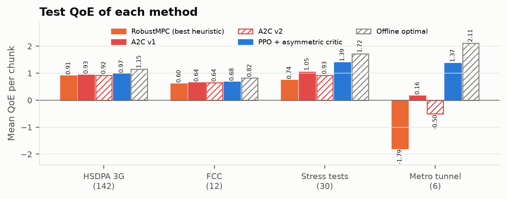
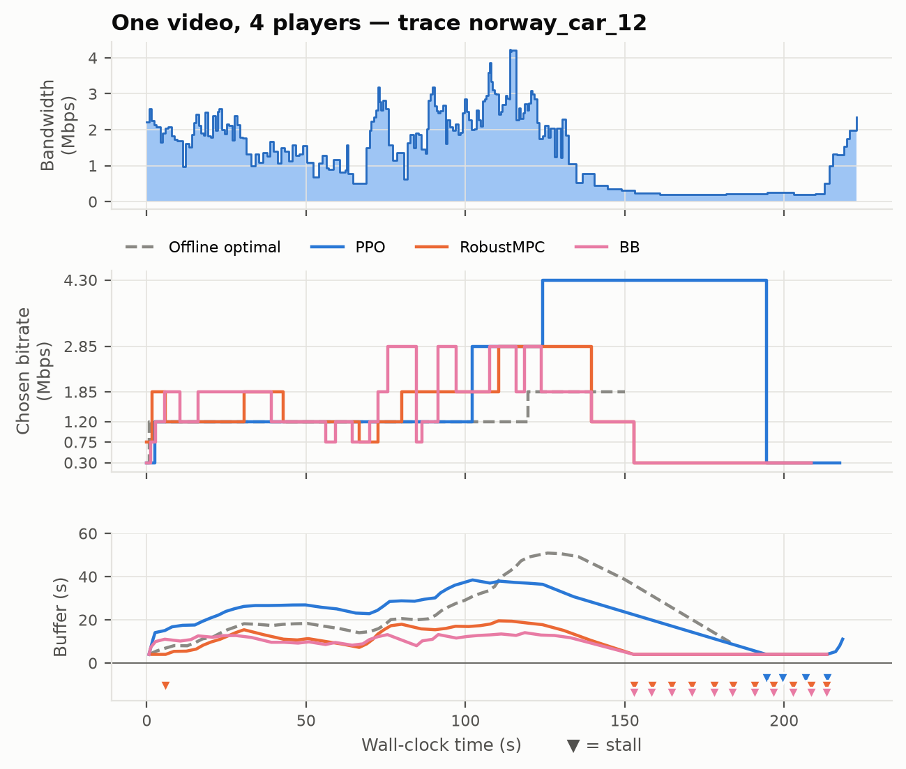
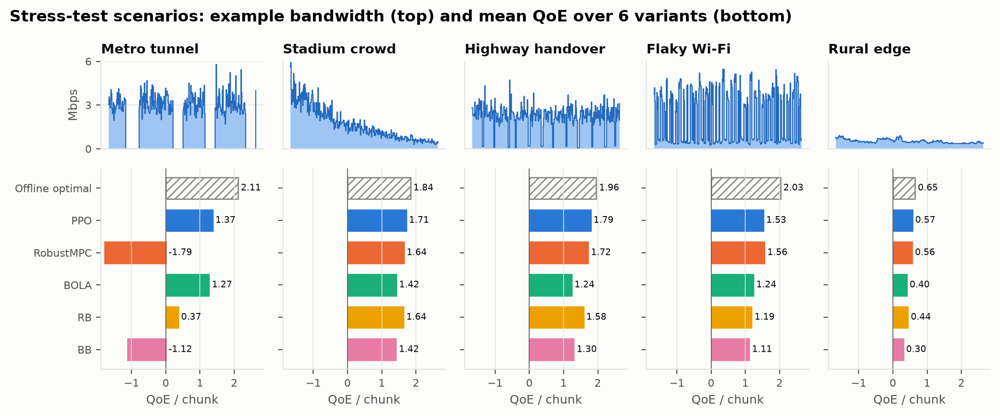
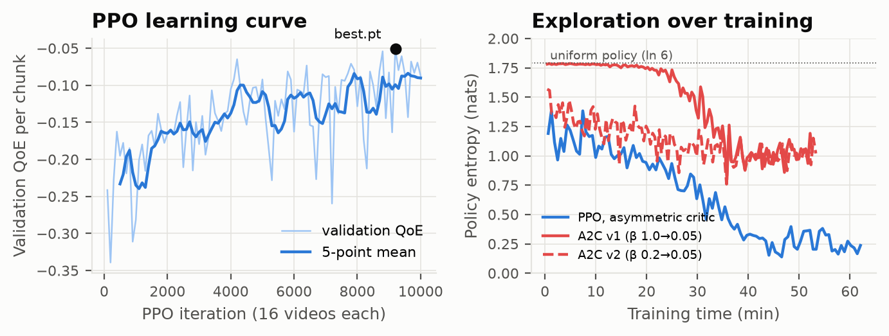
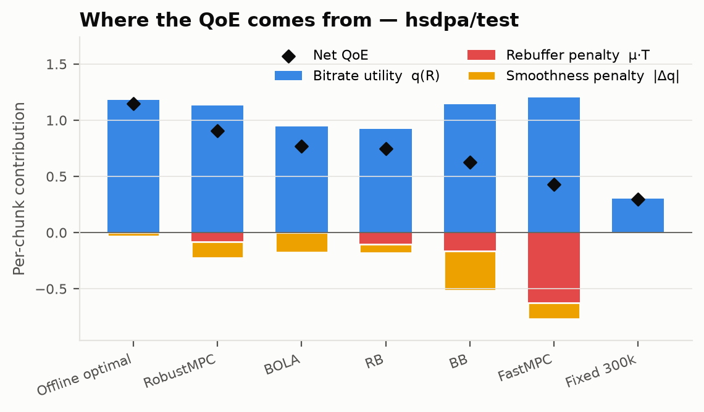

# Adaptive Bitrate Streaming with Deep Reinforcement Learning

**GitHub:** https://github.com/nk1044/ai-assignment2 · **Team:** Neeraj Kumar
**Report:** [`report/report.tex`](report/report.tex) (two-column LaTeX, compiled PDF: `report/report.pdf`)

A video player must choose, for every 4-second chunk, one of six qualities while the network bandwidth
fluctuates. If the quality is too high the buffer drains and the video **stalls**. If it is too low the
picture is blurry. If it changes too often, the viewer sees **flicker**.

We formulate bitrate selection as a Markov Decision Process and solve it with **PPO and an asymmetric
(privileged) critic**. The agent is trained in a trace-driven simulator on **real 3G and broadband
bandwidth traces**. It is compared against five classic ABR algorithms, two earlier RL agents (A2C), and
a dynamic-programming **offline optimum** that knows the future.

The heuristics and the optimum are used only as comparison points. The solution itself is a pure RL agent.



## Results

Mean per-chunk QoE (higher is better) on **unseen** test traces. Deterministic test protocol: every
method streams exactly the same networks.

| Method | Type | HSDPA 3G (142) | Stall s/video | Switches/video | FCC (12) | Stress tests (30) | Metro tunnel |
|---|---|---|---|---|---|---|---|
| *Offline optimal* | upper bound (knows future) | *1.145* | 0.01 | 2.4 | *0.819* | *1.716* | *2.11* |
| **PPO + asymmetric critic** | **RL (ours, final)** | **0.971** | 0.35 | **4.5** | **0.675** | **1.393** | **1.37** |
| A2C v1 | RL (ours, earlier) | 0.934 | 0.17 | 12.1 | 0.644 | 1.047 | 0.16 |
| A2C v2 | RL (ours, earlier) | 0.924 | 0.35 | 11.5 | 0.645 | 0.926 | −0.50 |
| RobustMPC | heuristic baseline | 0.907 | 0.91 | 9.5 | 0.604 | 0.738 | −1.79 |
| BOLA | heuristic baseline | 0.770 | 0.01 | 13.8 | 0.396 | 1.113 | 1.27 |
| Rate-based (RB) | heuristic baseline | 0.745 | 1.13 | 6.5 | 0.428 | 1.042 | 0.37 |
| Buffer-based (BB) | heuristic baseline | 0.626 | 1.80 | 25.3 | 0.344 | 0.602 | −1.12 |
| FastMPC | heuristic baseline | 0.431 | 6.82 | 10.6 | 0.252 | 0.330 | −3.24 |

- PPO beats the best heuristic (RobustMPC) on every test set:
  - **+7 %** on HSDPA and **+12 %** on FCC;
  - **+89 %** on the stress tests;
  - with **2× fewer quality switches** and **2.6× less stall time** on HSDPA.
- In a metro tunnel (bandwidth drops to 0 for 15–30 s), RobustMPC's throughput predictor collapses (−1.79),
  while PPO keeps a QoE of 1.37.
- PPO closes 27 % of the gap between RobustMPC and the offline optimum on HSDPA.
- Every run is logged in [`experiments/README.md`](experiments/README.md).

| | |
|---|---|
|  |  |
|  |  |

Other figures in [`plots/figures/`](plots/figures/):
- `g2` QoE bars
- `g4` per-trace CDF
- `g6` quality vs stall trade-off
- `data_traces` example traces

## RL Formulation

**Step** = one chunk decision; **episode** = one 48-chunk video (≈ 3.2 min) streamed over one trace.

**State** `s_t ∈ ℝ^{6×8}` (25 informative values):

| Row | Feature | Size | Normalisation |
|---|---|---|---|
| 0 | last chosen bitrate | 1 | ÷ 4300 kbps |
| 1 | buffer level | 1 | ÷ 10 s |
| 2 | throughput of the last 8 chunks | 8 | Mbps |
| 3 | download time of the last 8 chunks | 8 | ÷ 10 s |
| 4 | size of the next chunk at each of the 6 bitrates | 6 | MB |
| 5 | chunks remaining | 1 | ÷ 48 |

The future bandwidth is hidden, so for the agent the problem is a POMDP. The 8-step histories are the
standard approximate-Markov summary.

**Action** `a_t ∈ {0..5}` (discrete): 300, 750, 1200, 1850, 2850 or 4300 kbps.

**Reward** (QoE_lin, Yin et al. 2015), per chunk:

```
r_t = q(R_t) − 4.3 · T_t − |q(R_t) − q(R_{t−1})|        q(R) = bitrate in Mbps, T_t = stall seconds
```

μ = 4.3 = the top bitrate, so one second of stall costs as much as a top-quality chunk earns. Summed over a
video, the rewards equal the evaluation metric. QoE_log and QoE_hd variants are also supported.
**Discount** γ = 0.99.

**Transition** (trace-driven simulator, `abrsim/`):
- download time = chunk bytes integrated over the recorded bandwidth (× 0.95 payload) + 80 ms RTT;
- stall = max(download − buffer, 0);
- buffer ← max(buffer − download, 0) + 4 s;
- above 60 s of buffer the player sleeps.

Training adds ±10 % delay noise and random start offsets. Testing is noise-free and starts at the
beginning of every trace.

## Algorithm: PPO with an asymmetric critic

- **Actor** π(a|s) (≈ 266 k parameters):
  - Dense(128) on the last bitrate, buffer and chunks left;
  - Conv1D(128, k=4) branches on the throughput history, download-time history and next chunk sizes;
  - Dense(128) → softmax over 6 actions.
- **Critic** V(s, f) (≈ 348 k parameters): the same observation **plus privileged information** `f`. This
  is the true mean bandwidth over the next 8 × 4 s, read from the trace.
  - The critic exists only during training, inside the simulator, so it may use it. It gives sharper
    value estimates, and therefore lower-variance advantages.
  - The deployed actor never sees the future.
  - Feeding the critic the observation *and* `f` keeps the policy gradient unbiased under partial
    observability.
- **PPO:**
  - 16 parallel simulators stream one video each, giving 768 transitions per rollout;
  - GAE (γ = 0.99, λ = 0.95), normalised advantages;
  - 4 epochs × 4 minibatches of the clipped surrogate (ε = 0.2) with entropy bonus 0.1 → 0.01;
  - early stop at approximate KL > 0.03;
  - Adam (actor 1e-4, critic 1e-3), gradient clip 5.
- **Training:** 10 000 rollouts (≈ 1 h on a laptop CPU). The best checkpoint is selected on 12 held-out
  *training* traces × 4 start points; test traces are never used for selection.
- **Why PPO over A2C / DQN:**
  - A2C may take only one gradient step per rollout; PPO's clipping makes it safe to reuse each rollout
    4 times.
  - DQN's max-operator overestimates under heavy-tailed stall rewards.
- **Why it beat the earlier A2C agents:** A2C v1 kept a near-uniform policy for half of its training
  because its entropy bonus was too strong. A2C v2 fixed this, but noisy validation picked a weaker
  checkpoint. PPO combines a smaller entropy bonus, sample reuse, the privileged critic and a less noisy
  validation set.

## Baselines

| Baseline | Rule |
|---|---|
| Rate-based (RB) | highest bitrate ≤ harmonic mean of the last 5 throughputs |
| Buffer-based (BB, BBA-0) | lowest below 5 s of buffer, highest above 15 s, linear in between |
| BOLA | Lyapunov utility rule: argmax (V·(v_m + γp) − Q)/S_m |
| FastMPC / RobustMPC | enumerate all 6⁵ bitrate plans for the next 5 chunks with predicted bandwidth (RobustMPC discounts by the max recent prediction error); apply the first action |
| Offline optimal | dynamic programming over (last bitrate, buffer bin) with full knowledge of the trace: an upper bound, not a real algorithm |

## Installation

Requirements: Python 3.12, plus `numpy`, `torch`, `matplotlib` and `pytest` (see `requirements.txt`).
It runs on CPU and needs no GPU.

```bash
git clone https://github.com/nk1044/ai-assignment2.git
cd ai-assignment2
python3.12 -m venv .venv
source .venv/bin/activate            # Windows: .venv\Scripts\activate
pip install -r requirements.txt
pytest -q                            # 38 tests: simulator physics, baselines, oracle bound, PPO agent
```

All data and the trained agent (`models/ppo_asym.pt`) are included in the repository.

## Usage

### Web demo (for the presentation)

```bash
python demo/server.py                # opens http://127.0.0.1:8000
```

- **Choose a network:** a real 3G/FCC trace, a stress test (metro tunnel, stadium crowd, highway
  handover, flaky Wi-Fi, rural edge), or **draw your own bandwidth curve**.
- **Press ▶ Stream.** PPO, RobustMPC, BOLA, BB and (optionally) the offline optimum stream the same video
  side by side:
  - picture sharpness = chosen bitrate;
  - spinner = stall;
  - live buffer bar, QoE and switch counters;
  - a bandwidth/bitrate timeline and a final score table.
- **Direct links** (useful during a talk):
  - `http://127.0.0.1:8000/?trace=scenarios::metro_tunnel_0&autoplay=1`
  - `http://127.0.0.1:8000/?draw=crash&autoplay=1`
  - `?speed=16&oracle=0`
- **Options:** `--model models/ppo_asym.pt`, `--port 8000`, `--no-browser`.

### Evaluate the trained agent

```bash
# HSDPA 3G test set (142 traces) — PPO vs all baselines + offline optimal (~2 min)
python evaluate.py --oracle --agent PPO=models/ppo_asym.pt
python evaluate.py --oracle --agent PPO=models/ppo_asym.pt --traces fcc/test     # FCC broadband
python evaluate.py --oracle --agent PPO=models/ppo_asym.pt --traces scenarios    # stress tests
python evaluate.py --agent PPO=models/ppo_asym.pt --qoe log                      # other QoE definitions: log, hd
```

Each run prints a table (QoE per chunk, average bitrate, stall seconds, switches, startup delay) and writes
per-chunk and per-trace CSVs to `results/baselines/<traces>_<qoe>/`. `--traces` accepts:
- `hsdpa/test`, `fcc/test`, `scenarios`, `india`;
- `train` / `test` (all datasets);
- `a+b` to combine sets;
- or any directory of trace files.

### Figures

```bash
python plots/make_figures.py         # needs the three --oracle evaluations above; writes plots/figures/*.png|pdf
```

### Train an agent

```bash
python train.py --run-name ppo_asym 2>&1 | tee runs_ppo_asym.log          # ≈ 1 h on CPU
```

- **Output:** `runs/<name>/` with `config.json`, `log.csv`, `best.pt`, `final.pt` and `ckpt_*.pt`
  (one every 500 iterations).
- **Logged every 100 iterations:**
  - validation QoE;
  - entropy;
  - KL (how far an update moved the policy, normally < 0.03);
  - PPO epochs used.
- **Validation QoE is negative.** The validation traces include FCC outages with unavoidable stalls, so only
  the trend matters.
- **Hyperparameters:** every one is a flag (`python train.py --help`), e.g. `--iters`, `--entropy-start`,
  `--clip-eps`, `--ppo-epochs`, `--qoe log`.

```bash
# record a finished run in experiments/ (evaluates best.pt on all test sets, updates experiments/README.md)
python tools/record_experiment.py --run runs/ppo_asym --name PPO_asym --algo "PPO, asymmetric critic" --notes "..."

# variants
python train.py --run-name ppo_datasaver --lambda-range 0 2      # "data saver": reward − λ·MB, λ as an input
python train.py --run-name ppo_fcc_only --train-set fcc/train    # generalisation: train on FCC only
```

### Data and tools

```bash
python tools/prepare_traces.py       # re-download FCC + HSDPA traces and video sizes (pinned commit) into data/
python tools/make_scenarios.py       # regenerate the 30 stress-test traces
python tools/trace_logger.py --name delhi_metro --duration 600 --network "Jio 4G"   # record your own trace
python evaluate.py --oracle --agent PPO=models/ppo_asym.pt --traces india         # test on recorded traces
```

The trace logger downloads continuously (capped at 8 Mbps ≈ 60 MB/min, hard stop `--max-mb 400`) and
logs throughput once per second. The recording protocol is in `data/traces/india/README.md`.

## Reproducing the results

```bash
pytest -q
python train.py --run-name ppo_asym                                        # or use models/ppo_asym.pt
for t in hsdpa/test fcc/test scenarios; do
  python evaluate.py --oracle --agent PPO=runs/ppo_asym/best.pt --traces $t
done
python plots/make_figures.py
```

Everything is seeded: the trace splits, the simulator and validation. Test evaluation is fully
deterministic, so evaluating `models/ppo_asym.pt` reproduces the table above exactly. A new training run
reproduces it up to PyTorch's CPU non-determinism. The A2C agents were produced by commit `6d8faf4`
(`git checkout 6d8faf4`).

## Repository structure

```
abrsim/           simulator + MDP: config.py (constants), abr_env.py (StreamingSimulator, ABREnv),
                  traces.py (trace loading), video.py (chunk sizes)
agents/           networks.py (actor, privileged critic), ppo.py (PPO update), rollout.py (16 parallel envs),
                  policy.py (wraps a checkpoint for evaluation)
baselines/        heuristics.py (RB, BB, BOLA), mpc.py (FastMPC/RobustMPC), oracle.py (offline optimal DP)
train.py          training loop, validation, checkpoints → runs/
evaluate.py       runs any policies on a trace set → results/
demo/             web demo (server.py + index.html)
plots/            make_figures.py, style.py, figures/
tools/            prepare_traces.py, make_scenarios.py, trace_logger.py, record_experiment.py
models/           ppo_asym.pt — the trained agent
experiments/      recorded results + training logs of every RL run
data/             traces (fcc, hsdpa, scenarios, india) and EnvivioDash3 chunk sizes
report/           two-column LaTeX report + figures
docs/             detailed study notes (formulation, simulator, algorithms, viva Q&A, rebuild guide)
tests/            pytest suite
```

## Data

| Dataset | Train | Test | Source |
|---|---|---|---|
| Norway HSDPA 3G (bus, tram, metro, ferry, train, car) | 68 | 142 | Riiser et al., MMSys 2013 |
| FCC Measuring Broadband America | 47 | 12 | FCC; 20 % held out (seed 0) |
| Stress-test scenarios | – | 30 | generated (`tools/make_scenarios.py`) |
| Video: EnvivioDash3, 48 × 4 s chunks, 6 bitrates | | | DASH reference video |

The pre-processed traces are those released with Pensieve (mirror: github.com/godka/Pensieve-PPO, pinned
commit `a1b2579`). Details are in [`data/README.md`](data/README.md).

## Limitations

- **Open-loop traces.** Recorded bandwidth does not react to the player's own traffic (no TCP or
  congestion feedback). This is standard practice in ABR research.
- **One test video.**
- **Linear QoE** is a simplified model of perception.
- **Small FCC test set.** It has only 12 traces (± 1.8 std), so HSDPA (142) is the main benchmark.

## References

1. H. Mao, R. Netravali, M. Alizadeh. *Neural Adaptive Video Streaming with Pensieve.* SIGCOMM 2017.
2. X. Yin, A. Jindal, V. Sekar, B. Sinopoli. *A Control-Theoretic Approach for Dynamic Adaptive Video Streaming over HTTP.* SIGCOMM 2015.
3. T.-Y. Huang et al. *A Buffer-Based Approach to Rate Adaptation.* SIGCOMM 2014.
4. K. Spiteri, R. Urgaonkar, R. Sitaraman. *BOLA: Near-Optimal Bitrate Adaptation for Online Videos.* INFOCOM 2016.
5. J. Schulman et al. *Proximal Policy Optimization Algorithms.* arXiv 2017.
6. L. Pinto et al. *Asymmetric Actor Critic for Image-Based Robot Learning.* RSS 2018.
7. A. Baisero, C. Amato. *Unbiased Asymmetric Reinforcement Learning under Partial Observability.* AAMAS 2022.
8. H. Riiser et al. *Commute Path Bandwidth Traces from 3G Networks.* MMSys 2013.
9. V. Mnih et al. *Asynchronous Methods for Deep Reinforcement Learning.* ICML 2016.
